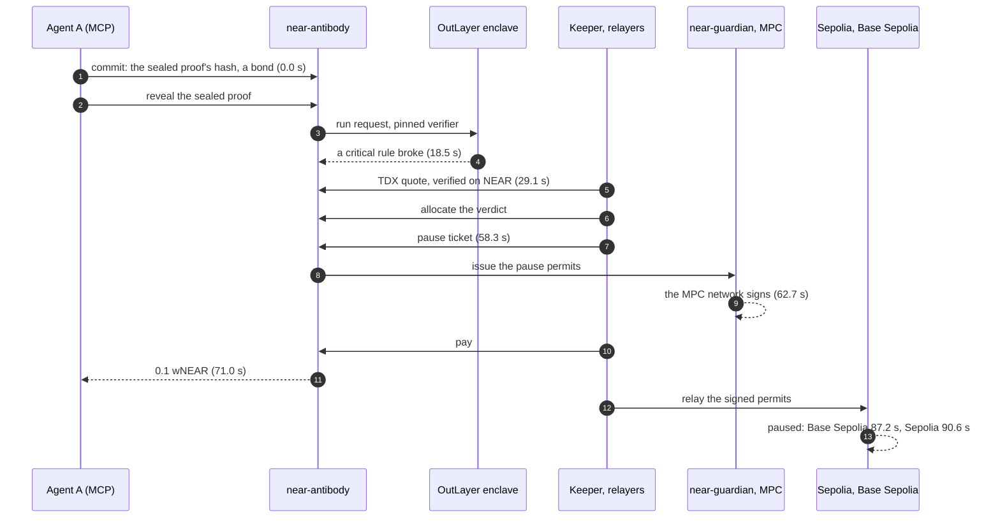
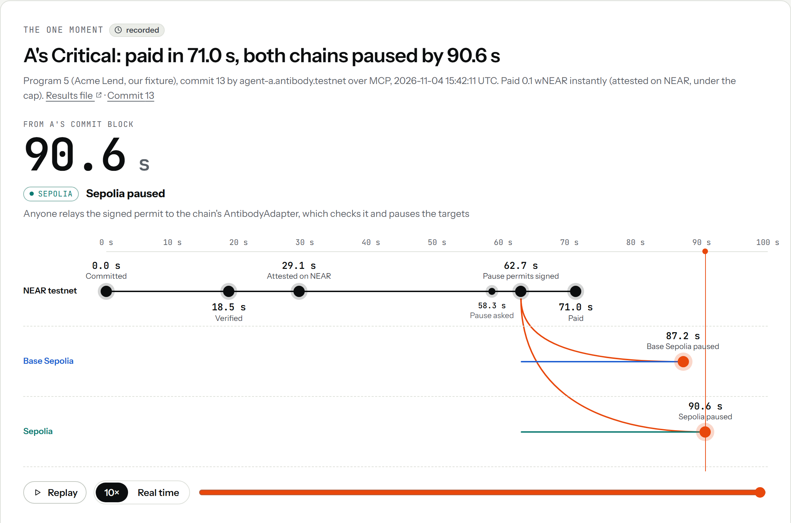

<div align="center">


# Antibody

**Bug bounties that pay on proof.** We don't read reports; we run them.

[Live site](https://antibody-near.vercel.app) · [Recorded run, replayed](https://antibody-near.vercel.app/moment) · [For judges](JUDGES.md) · [For AI agents](AGENTS.md)

[](https://github.com/Himess/antibody/actions/workflows/ci.yml)
[](https://github.com/Himess/antibody/releases/latest)
[](LICENSE)

</div>

Bug bounties judge text: a person reads every report. Once AI makes reports free to write, that stops
scaling. In January 2026, curl ended its bug bounty after a flood of AI-generated reports
([The Register](https://www.theregister.com/2026/01/21/curl_ends_bug_bounty/),
[BleepingComputer](https://bleepingcomputer.com/news/security/curl-ending-bug-bounty-program-after-flood-of-ai-slop-reports/)).

**Antibody judges code instead.** Submit exploit code, not a report: if it breaks the project's rules,
you are paid automatically, and a critical bug pauses the protocol on every chain it runs on. Nobody has
to read a report.

How: a hunter, a person or an AI agent, submits a sealed proof of an exploit. OutLayer's enclave, secure
hardware, re-runs it against the rules the project committed on NEAR, and NEAR checks the enclave's
attestation before an instant payout. A Critical in the project's pause policy, once attested on NEAR,
pauses the protocol on every chain the project registered.

It runs on NEAR testnet today, with every contract locked. In the recorded run, an agent's critical
finding, sent over MCP, was paid in 71.0 s and the protocol was paused on both chains by 90.6 s
([The one moment](#the-one-moment)). Off-the-shelf Claude Code ran the loop over MCP on the practice
program 16 times out of 16, every commit ending `Done:Paid`.

## Try it in two minutes

The release binary has the testnet deployment built in: no repository, no account and no key.

**1. Download it and check its sha256**, in an empty folder.

```bash
# Linux x86_64
V=v0.6.1; F=antibody-x86_64-unknown-linux-gnu
curl -fsSLO https://github.com/Himess/antibody/releases/download/$V/$F
curl -fsSLO https://github.com/Himess/antibody/releases/download/$V/$F.sha256
sha256sum -c $F.sha256 && chmod +x $F && mv $F antibody
```

```bash
# macOS (Apple silicon)
V=v0.6.1; F=antibody-aarch64-apple-darwin
curl -fsSLO https://github.com/Himess/antibody/releases/download/$V/$F
curl -fsSLO https://github.com/Himess/antibody/releases/download/$V/$F.sha256
shasum -a 256 -c $F.sha256 && chmod +x $F && mv $F antibody
# downloaded with a browser instead of curl: xattr -d com.apple.quarantine ./antibody
```

```powershell
# Windows x86_64 (PowerShell): prints OK, or MISMATCH (then delete antibody.exe and download it again)
$V="v0.6.1"; $U="https://github.com/Himess/antibody/releases/download/$V"
Invoke-WebRequest "$U/antibody-x86_64-pc-windows-msvc.exe" -OutFile antibody.exe -UseBasicParsing
Invoke-WebRequest "$U/antibody-x86_64-pc-windows-msvc.sha256" -OutFile antibody.sha256 -UseBasicParsing
if ((Get-FileHash antibody.exe -Algorithm SHA256).Hash.ToLower() -eq (Get-Content antibody.sha256).Split(" ")[0]) { "OK" } else { "MISMATCH" }
```

On Windows, type `.\antibody.exe` wherever this page says `./antibody`. Each file also has a build
provenance attestation: `gh attestation verify <file> -R Himess/antibody` (the GitHub CLI, signed in).

**2. Read the live deployment.** View calls only:

```bash
./antibody judge
```

It prints each contract's locked status (code hashes with `--json`), and every program's verdicts, payouts
and pauses, with a progress line on stderr as it reads, four programs at a time (about 15 s). `judge` and `try` read FastNEAR's
public RPC, which limits requests: when it answers `-429`, reads move to two other public testnet RPCs for a
while, and a transaction waits and goes again. `./antibody --rpc <url> judge` picks another primary RPC.

**3. Run a practice bounty end to end.**

```bash
./antibody try --name <you>     # any new lowercase name
```

It gets a practice account, seals the public tutorial proof, commits and reveals it, and settles it,
printing each step as it happens and a link for every transaction at the end. It ends `Done:Paid` in one
to three minutes when the run is attested on NEAR: 43.7 s and 39.9 s in the recorded run, 36.4 s and 44.4 s
on 2026-11-08's fresh practice program, about three minutes when the public RPC rate-limits. While new
worker images wait their two-day delay, the payout waits the program's 60 s challenge window instead (91 to
95 s for the paid runs in [docs/results/byo-2026-11-07.json](docs/results/byo-2026-11-07.json)). The output
says which path it took.

The practice vending contract vends a capped number of accounts an hour (30 through 25 November), counted
by the UTC clock hour; when the hour's are taken, the error says when the count starts again, and nothing is
spent. [/try](https://antibody-near.vercel.app/try) shows how many are left. A try that stopped part-way goes on where it
stopped when you run it again with the same name. The same binary runs in Docker:
`docker run --rm ghcr.io/himess/antibody:v0.6.1 judge`.

## How it works

1. **A project opens a program.** Before a launch or an upgrade, it commits on NEAR its rules as code, a
   payout table and an escrow.
2. **Anyone submits a sealed proof:** a sequence of calls, with a small bond. Nobody outside the enclave
   and OutLayer's keystore, the project included, can read it before its verdict.
3. **A verifier re-runs it inside an enclave** (a TEE), on chain state proven at the program's anchor
   block, and reports which rule broke, where, and the impact.
4. **NEAR pays automatically.** The first proof of each bug (each rule and entry point) is paid: in
   seconds below the program's instant cap once the verdict is attested on NEAR, else after the program's
   challenge window. A proof that breaks nothing loses its bond to the program's escrow.
5. **A critical bug pauses the protocol on every chain** the project registered, once its verdict is
   attested on NEAR (T1) and if its rule is in the project's pause policy. The project's fix ships only
   once every paid proof fails against it.

<picture>
  <source media="(prefers-color-scheme: dark)" srcset="docs/assets/architecture-dark.svg">
  
</picture>

Every component and the code behind it: [docs/architecture.md](docs/architecture.md).

**What NEAR makes possible:**

- **One contract settles everything.** near-antibody holds each program's terms and escrow, and applies
  them to every verdict in seconds.
- **Hardware attestation, verified on chain.** NEAR checks the enclave's Intel TDX quote before an
  instant payout.
- **Pauses on other chains.** NEAR's MPC network signs the pause and release permits that the protocol's
  Ethereum contracts accept.
- **Proven state.** The Ethereum light client on NEAR confirms each program's anchor block, the block its
  proofs run on; an anchor it cannot confirm is labelled project-attested.
- **Agents that cannot run off with funds.** An AI agent works through a NEAR sub-account that cannot
  withdraw, within a bond budget.

## The one moment

On 2026-11-04, on the locked testnet deployment, our scripted test agent A submitted over MCP a sealed
proof of a critical bug in Acme Lend, our deliberately vulnerable test protocol on Sepolia and Base
Sepolia. Counted from the block of its commit:

| Time | What happened |
|---:|---|
| 18.5 s | The enclave's verdict: a critical rule broke |
| 29.1 s | The verdict attested on NEAR |
| 71.0 s | 0.1 wNEAR paid to agent A |
| 90.6 s | The protocol paused on both chains |

Who sent what, in order (the times are from the same commit block):



<a href="https://antibody-near.vercel.app/moment">
  <picture>
    <source media="(prefers-color-scheme: dark)" srcset="docs/assets/moment-dark.png">
    
  </picture>
</a>

Replay it with every transaction: [antibody-near.vercel.app/moment](https://antibody-near.vercel.app/moment).
Check every claim yourself: [JUDGES.md](JUDGES.md) gives each one a command, the output to expect and the
transaction behind it.

The same moment runs again every day around 03:00 UTC, on a fresh Acme Lend at new addresses: the
[daily drill](docs/drill.md) opens a program, lets agent A submit its proof over MCP, and checks the
verdict, its attestation on NEAR, the instant payout and the pause on both chains. Each drill that passed
is listed under the recorded run on [/moment](https://antibody-near.vercel.app/moment), and
[/status](https://antibody-near.vercel.app/status) says whether the latest one passed, or where it
stopped. The first to pass ran on 2026-11-08 ([results](docs/results/drill-2026-11-08.json)); its times
are longer than the recorded run's because its reveal waited for a rate-limited RPC.

## How a verdict is checked

Every verdict carries one of three levels. The CLI and JUDGES.md print them as T0, T1 and T2.

| Level | What vouches for it |
|---|---|
| **Enclave verdict** (`T0`) | OutLayer delivers the enclave's verdict. A payout waits the program's challenge window (60 s), and above the instant cap a second OutLayer run must agree. Nobody files challenges today, so under the cap a T0 verdict is paid when its window ends ([docs/limitations.md](docs/limitations.md)). |
| **Attested on NEAR** (`T1`) | The run's Intel TDX quote, which binds the pinned verifier, its input and its output, is verified on NEAR. Instant payouts need it. |
| **Zero-knowledge proof** (`T2`) | An SP1 proof that re-running the verifier on the same input gives the same result, checked on NEAR by near-t2. Live on testnet since 2026-11-07, for disclosed verdicts; no payout depends on it. |

All three rest on the same determinism: the native, enclave and zero-knowledge builds of the verifier give
the same receipt, byte for byte. Details and checks: [docs/trust.md](docs/trust.md).

## Bring your own proof

Write a proof yourself, by hand or with an agent, still with no account. `hunt start` gets an account and
writes a workspace (the rules, the sources, a Foundry harness, the proof format), `check` runs the verifier
on your machine, and `hunt submit` seals, commits and settles your proof:

```bash
./antibody hunt start --name <you> --vending practice.antibody.testnet
cp hunt-<you>/proof.example.bundle.json hunt-<you>/proof.bundle.json   # then make it yours (PROOF.md)
./antibody check --program <id> --bundle hunt-<you>/proof.bundle.json   # the program hunt start printed
./antibody hunt submit --name <you> --vending practice.antibody.testnet --poc hunt-<you>/proof.bundle.json
```

On testnet (2026-11-07): two accounts paid on two vaults, a proof that breaks no rule ending `NoViolation`
with its bond forfeited, and a proof with two calls where one is allowed, judged `InvalidPoC`, its bond
forfeited ([results](docs/results/byo-2026-11-07.json)).

## For AI agents

`antibody mcp` serves the same loop as MCP tools; `hunt_start`, `check_poc` and `hunt_submit` need no
account. Every result is marked as untrusted data, and file access stays inside a workspace. An agent
account is a NEAR sub-account that cannot withdraw, with a bond budget and a per-commit cap. Setup:
[AGENTS.md](AGENTS.md). Measured on testnet (2026-11-08): Claude Code, with these tools and the release binary,
took 10 of 10 runs with the tutorial proof, and 6 of 6 writing the proof itself (with file tools in its workspace),
to a commit that ended `Done:Paid`: 7 and 3 of them within the agent's own call, the rest once the services' keeper
settled. Practice payouts go back to the vending contract ([docs/agent-runs.md](docs/agent-runs.md)).

## For projects

- **Rules as code:** an `IAntibodyInvariants` contract or Foundry `invariant_*` functions
  ([docs/foundry.md](docs/foundry.md)). The drafter proposes a first set
  ([docs/invariants-drafting.md](docs/invariants-drafting.md)), and `antibody invariants validate`
  checks a manifest before it goes on chain.
- **Rule strength:** `antibody invariants strength` counts the code mutants your rules catch; Acme's
  catch 8 of 28 ([docs/rule-strength.md](docs/rule-strength.md)).
- **No staging deployment needed:** fork mode deploys the program's contracts inside the verifier
  ([docs/fork-mode.md](docs/fork-mode.md)).
- **NEAR apps can act on verdicts,** like a treasury that freezes on a critical one
  ([docs/verdict-guard.md](docs/verdict-guard.md)).
- **Immune memory on pull requests:** every paid proof, sealed or not, re-runs inside the enclave against the
  pull request's code, through near-antibody's rounds, and the check fails if one still breaks a rule. On the
  [demo repository](https://github.com/Himess/antibody-immune-demo), the pull request that brings a paid bug
  back is red and the harmless one green. A second check re-runs on the runner the proofs it can read, the
  only one a fork's pull request gets ([docs/immune.md](docs/immune.md)).

## Checked and attacked

- **12 settlement properties,** each a Quint invariant checked by Apalache and 20,000 random traces, and
  replayed against the rule core near-antibody runs; **41 Kani proofs** (16 harnesses, one of them for 26 precisions) of the payout arithmetic and every
  escrow movement ([docs/properties.md](docs/properties.md)).
- **37 findings from attacking our own system,** each fixed and pinned by a test, and what every attack
  costs the attacker ([docs/attacks.md](docs/attacks.md); threat model:
  [docs/threat-model.md](docs/threat-model.md)).
- **Fuzzing and golden vectors:** the parsers (manifests, witnesses, sealed payloads) are fuzzed, every
  format two components share has golden vectors, and the native and wasm verifiers agree byte for byte
  on every fixture.
- **CI on every change:** the model and its trace replay, the Kani proofs, the verifier (native and wasm),
  the contracts, the site, and the whole story end to end in a sandbox
  ([latest runs](https://github.com/Himess/antibody/actions/workflows/ci.yml)).

## Run it from source

The whole story also runs offline, in a sandbox with mocked external services (Linux or macOS). This
builds everything, runs the story with every outcome asserted (about nine minutes), then keeps the
sandbox up:

```bash
make serve
```

What it runs and how to query it: [docs/sandbox.md](docs/sandbox.md). The site: [web/README.md](web/README.md).
The architecture: [docs/architecture.md](docs/architecture.md).

## Deployment

On NEAR testnet, every contract locked (no full-access keys):

| Contract | Account |
|---|---|
| near-antibody: programs, verdicts, payouts | `bounty.antibody.testnet` |
| near-guardian: pause and release permits | `guardian.antibody.testnet` |
| Practice vending: accounts for the practice program | `practice.antibody.testnet` |
| Verdict guard: a NEAR app that reacts to verdicts | `guard.antibody.testnet` |
| near-t2: zero-knowledge proofs | `zk.antibody.testnet` |

Code hashes, the verifier build and the source commit are pinned in
[deployments/near-testnet.json](deployments/near-testnet.json); `./antibody judge` reads them live for every
contract above. The practice vending contract counts as locked when its only key is the public vend key, a
function-call key limited to `vend` and `reclaim`.

Full table: [docs/deployment.md](docs/deployment.md).

## Limits

Testnet only: wNEAR on testnet has no value, and Acme Lend and the practice vaults are our own deliberately
vulnerable test fixtures. Only rule breaks are paid automatically, a proof runs within one block, and
Ethereum (Sepolia) is the chain proofs run against; other chains are pause and release targets. The full
list: [docs/limitations.md](docs/limitations.md).

## Roadmap

- **Pull requests:** working on testnet, sealed proofs re-run inside the enclave through rounds, on every
  pull request of [the demo repository](https://github.com/Himess/antibody-immune-demo)
  ([docs/immune.md](docs/immune.md)); built, not yet run on testnet, a bounty window per pull request; next,
  a check-only proposal mode.
- **Zero-knowledge by default** above a payout cap (near-t2 is live on testnet).
- **NEAR contracts** as a second target VM.
- **Multi-block proofs** with a bounded time warp.
- **The mainnet path:** external audits, coverage partners, the fee model in production.

All 17 items, with what is done: [docs/roadmap.md](docs/roadmap.md).

## Hackathon

- **Tracks:** AI Security & Defense (`security`, primary): proofs, not reports, judged in an enclave, with a
  pause on every chain the project registered. Agent Economy (`agents`): agents earn on proof, through
  accounts that contain them. The tracks' hints this builds on:
  - **TEE attestation:** each run's Intel TDX quote is verified on NEAR before an instant payout (T1).
  - **Function-call keys:** an agent's key may commit, reveal and retry, and can never withdraw or transfer.
    A pull-request check's keys may only propose a round (`propose_round` and the manifest's upload) or open
    one (`open_round`, `allocate`). Each practice account holds one key scoped to its own contract.
  - **Agent security:** an agent works through a NEAR sub-account that cannot withdraw, within a bond budget
    and a per-commit cap that count losses; a commit outside them is refused.
  - **Agent commerce:** agents earn bounties, paid by near-antibody in wNEAR (the measured runs above).
  - **Chain Signatures:** NEAR's MPC network signs the pause and release permits that the protocol's
    contracts on Sepolia and Base Sepolia accept.
- **Built during the hackathon:** all code was written after the October 19, 2026 announcement, and the
  commits reflect when it was written. The first commit is large: it holds the code written on November 1
  and 2, as the `hackathon-start` tag's message says. Tags: `hackathon-start`, milestone tags, and `hackathon-submission`
  at submission; every change since the first commit:
  [hackathon-start...main](https://github.com/Himess/antibody/compare/hackathon-start...main).
- **AI-assisted:** written with Claude Code (Claude Opus 5.5). The design, the rules and every decision on
  scope were reviewed by the team.
- **Business model:** the requester pays verification at cost. Revenue is a fee on payouts and a fee per
  release permit, both pinned per program, and later a paid tier for the drafter, rule strength and
  analytics. Forfeited bonds are never revenue: they go to the program's escrow.

<details>
<summary><b>Libraries and tools</b></summary>

Direct dependencies, by license:

- MIT or Apache-2.0: alloy, reth 2.2, rsp, serde, serde_json, clap, reqwest, borsh, sha2, hkdf,
  chacha20poly1305, k256, getrandom, near-sdk 5.9, proptest, futures-util, and wasmi 2.0 (verifier v2's
  NEAR engine, `crates/verifier-near`);
- MIT: revm 38, axum, tokio, bincode;
- BSD-3-Clause: ed25519-dalek, x25519-dalek;
- Apache-2.0 with LLVM exception: wasmtime 28.
- T2 (`crates/zk/*`; no payout depends on it), MIT or Apache-2.0: SP1 6.10.0's `sp1-zkvm`,
  `sp1-core-executor` and `sp1-sdk` (the prover client, `crates/zk/prove`), and sp1-patches' `sha2`,
  `sha3`, `k256`, `p256` and `substrate-bn` (the versions rsp uses).
  - `contracts/near-t2` uses no SP1 crate. Its Groth16 check is written for NEAR's alt_bn128 host
    functions, and its tests read SP1's published verifying keys and fixture proof.
  - `substrate-bn` (MIT or Apache-2.0) also runs the sandbox's MOCK T2 prover.
- Tools: Foundry, Quint and Apalache, Kani, near-sandbox, SP1's `cargo prove` 6.10.0; proofs come from
  SP1's prover network.

Patches: `third_party/patches/` holds four: two small build fixes (for `kzg-rs` and `near-vm-runner`),
and two decoding fixes in the verifier's path (`bitvec` and `revm-bytecode`: a malformed witness becomes
a decode error instead of a panic; SA-25 in [docs/attacks.md](docs/attacks.md)). What each changes:
[third_party/patches/README.md](third_party/patches/README.md).

</details>

## Repository layout

| Path | Contents |
|---|---|
| `crates/verifier` | The deterministic verifier: program mode, rounds, fork mode, receipts, TEE modes, sealed submissions |
| `crates/witness` | Witness builder: traces a proof through the verifier's own path, base witnesses, submissions from the base |
| `crates/rules` | The settlement rule core near-antibody runs; Kani proofs |
| `crates/cli` | `antibody`: CLI, MCP server, practice, judge view, rule strength, Foundry compatibility, drafter |
| `crates/services` | Indexer, API, keeper, relayers, notifier, monitoring, sandbox mocks, the demo |
| `crates/zk` | Zero-knowledge proofs of disclosed verdicts (SP1): the guest program and the prover client |
| `crates/runner` | A wasmtime host with OutLayer's engine configuration, for local wasm runs (native == wasm checks) |
| `crates/verifier-near`, `crates/verifier-v2` | Verifier v2: a NEAR execution engine (wasmi) and the binary that adds it to v1; built and tested, not deployed ([docs/near-targets.md](docs/near-targets.md)) |
| `contracts/near-antibody`, `near-guardian`, `near-t2`, `practice-vending`, `practice-account`, `verdict-guard` | The NEAR contracts |
| `contracts/evm` | Acme Lend (deliberately vulnerable), its rules, proofs and fixes; the practice vaults; the adapter |
| `web/` | The site: the one moment, programs, commits, the browser try, judges' checks, trust, status |
| `formal/` | The Quint model of the settlement rules |
| `fixtures/`, `golden/` | Recorded witnesses and verdicts; golden vectors |

## Safety

Acme Lend and the practice vaults are **deliberately vulnerable test fixtures**, with textbook bugs labeled
in their code. Their proofs exist only for those bugs, and everything runs on testnets or local chains.
Antibody verifies; it does not hunt. See [SECURITY.md](SECURITY.md). Keys live only in the git-ignored
`.secrets/` and `.env`, and gitleaks runs in the pre-commit hook and in CI.

## License

MIT (see [LICENSE](LICENSE)). Third-party code is used under its own licenses.
