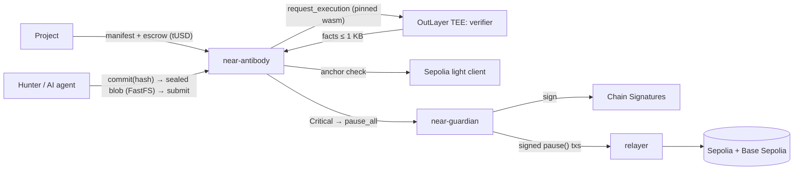

# Antibody: bug bounties that pay on proof

[](https://github.com/Himess/antibody/actions/workflows/ci.yml)

> Proof, not reports. Your invariants are your bounty terms.

**The problem.** Bug bounties judge text: a person reads every report. In January 2026, curl ended its
bug bounty after a flood of AI-generated reports
([The Register](https://www.theregister.com/2026/01/21/curl_ends_bug_bounty/),
[BleepingComputer](https://bleepingcomputer.com/news/security/curl-ending-bug-bounty-program-after-flood-of-ai-slop-reports/)).
When reports are cheap to produce, judging text does not scale.

**Antibody judges code.**
- **A project opens a program** before a launch or an upgrade. It commits, immutably on NEAR:
  - an anchor block of its staging deployment;
  - its rules as code: an invariants contract and a severity/payout table;
  - an escrowed reward pool.
- **Hunters (people or AI agents) submit sealed proofs of concept.**
- **A deterministic verifier re-executes each PoC** on the proven anchor state inside an OutLayer TEE. It
  reports which committed invariants broke, in which function, and the impact.
- **near-antibody applies the committed rules:**
  - the first finder of each (invariant, function) key is paid;
  - a duplicate is shown verifiable proof of the earlier claim;
  - the project's known issues are declared at t0;
  - bonds deter slop: refunded on any Violation, forfeited on NoViolation or InvalidPoC;
  - a Critical makes Chain Signatures pause the protocol on every chain where it runs.

No LLM decides who gets paid. Report text is never read; only the PoC's code runs. The one human step is
the T0 arbiter: a payout above the instant cap that someone challenges is resolved by the contract owner,
unless a T1 confirmation resolves it first.

## Run it (offline, one command)

```bash
make demo
```

Prerequisites:
- **OS:** Linux x86_64 with glibc 2.38 or newer (Ubuntu 24.04+, Debian 13), which near-sandbox 2.14.0
  requires. macOS arm64 is supported by near-sandbox but is not tested in CI.
- **Tools:** Rust (rustup), Foundry, Python 3 and a C compiler (clang or gcc).
- **Network:** the first build downloads toolchains, crates, Foundry components and near-sandbox.

Anywhere else, use Docker:

```bash
docker build --platform linux/amd64 -t antibody-demo .
docker run --rm --platform linux/amd64 antibody-demo
```

It needs no keys and no funds. It builds everything, then:
1. checks the recorded fixtures natively and as wasm;
2. runs the contract rule tests;
3. plays the whole flow on near-sandbox with two anvils, using MOCK OutLayer and MOCK MPC driven by the
   real verifier, and asserts every outcome.

CI runs these steps on every push to `main` and on pull requests:
- fixtures: job `verifier`;
- rule tests: jobs `evm` and `near`;
- sandbox end to end: job `e2e`.

The `docker demo` workflow runs the container.

| Step in the demo | What happens | Asserted |
|---|---|---|
| Program | Acme Lend's manifest committed on NEAR; 25,000 tUSD escrowed | `program_created` |
| t0 | The project's known issue is verified by the same TEE path and claims its key | `KnownIssue` |
| Agent A over MCP | `antibody mcp` with a function-call key: commit, then sealed submit | Paid 10,000 tUSD after the T0 delay |
| Guardian | A's Critical makes near-guardian sign `pause()` for two chains; the relayer broadcasts | `paused()` on both chains, 0.5 s after the verdict |
| B–F | B paid (3,000); C rejected; D a duplicate of A; E known; F paid as a new key | All five outcomes |
| Round 1 | The project ships the fix for A's bug as a code override; the TEE re-runs the claimed findings | A released; B, F and the known issue carried |
| Disclosure | One TEE run publishes every content key; `antibody verify` re-checks D against A | Same rule, same function, committed earlier |

Results are written to `target/demo/results.json`. One CI run's numbers are in
[docs/measurements.md](docs/measurements.md).

## The fixture: six scripted agents against "Acme Lend"

`contracts/evm/src/acme/` is a fictional lending protocol with **four bugs planted on purpose**
(DELIBERATELY VULNERABLE TEST FIXTURE: never deploy it to mainnet). Its invariants define three rules:
solvency at a committed reference price, accrued fees plus the treasury balance never decreasing, and a share price that never
falls.

| Submission | Verdict | Key (invariant, function) | Outcome |
|---|---|---|---|
| Known issue (project, t0) | Violation | share_price, `AcmeVault.withdraw` | Known issue, no payout |
| A: spot-price collateral via a swap (submitted over MCP) | Violation | solvency, `AcmeLend.borrow` | Paid (Critical) |
| B: `sweepFees` without access control | Violation | fees_to_treasury, `AcmeVault.sweepFees` | Paid (High) |
| C: profitable arbitrage, plus a prompt injection in the report | NoViolation | none | Rejected, bond forfeited |
| D: A's bug via a donation + `sync()` | Violation | solvency, `AcmeLend.borrow` | Duplicate of A, with proof |
| E: withdraw rounding | Violation | share_price, `AcmeVault.withdraw` | Known, no payout |
| F: `repay` ignores `transferFrom`'s return value | Violation | solvency, `AcmeLend.repay` | Paid: a new key under the same rule |

[`fixtures/acme-local/expected.json`](fixtures/acme-local/expected.json) records, for each submission:
- the verdict and its keys;
- the HMAC fingerprint tags;
- the impact at the reference prices;
- the receipt hash.

CI re-runs every fixture natively and as `wasm32-wasip2` under wasmtime with OutLayer's engine
configuration, and requires byte-identical output (`scripts/demo/check_fixtures.py`).

## How it works



- **Verifier** (`crates/verifier`). Program mode:
  - binds the witness to the manifest hash and the anchor header, and verifies every Merkle-Patricia proof;
  - injects the invariants at a reserved address that only evaluation calls can see;
  - requires `check(snapshot()) == 0` at the anchor;
  - runs the PoC from fresh salted senders with a bounded endowment;
  - records, for each broken invariant, the protocol-entry call where it last flipped (its root-cause
    fingerprint);
  - measures the impact as min(protocol loss, attacker gain) at committed prices.

  The same build runs natively and under wasmtime with OutLayer's engine configuration, byte for byte.
  The run on OutLayer itself is part of the pending live deployment.
- **Sealed submissions** ([docs/crypto-spec.md](docs/crypto-spec.md)):
  - X25519 + HKDF-SHA256 + ChaCha20-Poly1305 to a verifier key derived inside the TEE from a
    `PROTECTED_` secret, bound to the wasm hash and to near-antibody as the caller;
  - commit-reveal fixes priority;
  - the project receives a key wrap for every Violation, so a paying project can read what it pays for;
  - a disclosure run publishes every content key, so anyone can re-verify everything.
- **Rules** (`contracts/near-antibody`, [docs/architecture.md](docs/architecture.md)):
  - keys are `(slot, HMAC tag)`, with priority by commit order;
  - duplicates and known issues get no payout, but their bond is refunded and they get the earlier
    claim's proof;
  - T0 delay and `challenge()` above a cap;
  - reputation and NEP-297 events.
- **Rounds** ([docs/rounds.md](docs/rounds.md)). A fix is committed as code overrides at the same anchor.
  The TEE re-runs each claimed finding with the same PoC hash, and keys that no longer break are
  released. So a second bug in the same function can be paid once the first is fixed. The contract
  rejects a round that changes anything but target code.
- **Guardian** (`contracts/near-guardian`). It signs EIP-1559 `pause()` transactions for every
  registered chain through `v1.signer-prod.testnet`, and `ecrecover` checks each signature. The signed
  transactions are public, so anyone can relay them.
- **Agents.** `antibody mcp` exposes 8 tools over stdio: list and get programs, fetch the environment,
  check a PoC locally, commit, submit, status, verify a receipt. An agent gets a NEAR function-call key
  that can only commit, submit and upload its sealed blob: it cannot attach deposits or withdraw.
- **Backend** (`crates/services`, [docs/api.md](docs/api.md)): indexer, read-only API, pause relayer,
  T1 relayer and notifier.

## Trust: tiers, and what is mock

Full table: [docs/trust.md](docs/trust.md).

| Tier | Who vouches for a verdict | Status |
|---|---|---|
| **T0** | OutLayer's operator delivers the TEE worker's output. Above the instant cap, payouts wait a challenge window; anyone may `challenge()` | Implemented. Live run pending (see Deployment) |
| **T1** | The run's TDX quote, verified on NEAR (`confirm_tee`). Its `report_data` must bind the exact input and output that near-antibody recorded, the pinned wasm, the caller and the secrets. The worker image must be pinned | Implemented and tested with a real quote from a third-party OutLayer run (request 6496). On 2026-11-02, `antibody tee check --request-id 6496` verified it live with a free view call: `Verified`, `UpToDate`. When OutLayer's on-chain collateral expires (2026-11-08), fresh collateral comes from Intel PCS (`--collateral pcs`, verified the same day); `fixtures/t1/` keeps the recorded answer |
| **T2** | zk proof of the same execution | Roadmap |

**What is mock:**
- **The mainnet view** (`/v1/mock/mainnet`, `"mock": true`). It is recorded or synthetic data only. No
  mainnet transaction is ever sent. The mainnet light-client figures come from the previous prototype's
  recorded results (`fixtures/mock-mainnet/v03-evidence.json`).
- **The sandbox demo.** It uses MOCK OutLayer and MOCK MPC contracts, resolved by the real verifier with
  a TEST seed and a TEST secp256k1 key.
- **The fixture keys.** The fixtures' `k_program` is a TEST key.

## Deployment (NEAR testnet, Sepolia, Base Sepolia)

**Status: not deployed yet. It is waiting for testnet funds and archive RPC keys.**
`scripts/deploy/testnet.sh` is an idempotent runbook. It:
1. creates `antibody-hq.testnet` and its sub-accounts;
2. derives the guardian's EVM address;
3. deploys Acme Lend to Sepolia (seeded) and Base Sepolia (pause-only) at the same CREATE2 addresses;
4. publishes the verifier wasm as a GitHub release;
5. deploys tUSD, near-antibody and near-guardian;
6. creates the verifier seed as an OutLayer `PROTECTED_` secret;
7. registers both chains;
8. configures T1 with OutLayer's latest approved worker images.

**The live story.** Two more steps run it with nothing mocked.
1. `python scripts/demo/acme_fixture.py --net sepolia --rpc "$SEPOLIA_RPC" --anchor N` builds the
   Sepolia fixture at block N, natively, and checks every expected verdict before anything is spent.
   N must be a finalized block that the light client already has; `antibody anchor-check --block N`
   tells.
2. `target/release/antibody-services live` runs the Acme story on NEAR testnet, Sepolia and Base
   Sepolia:
   - the program, with its anchor checked by the light client;
   - the known issue;
   - agent A over MCP;
   - the MPC-signed pause on both chains;
   - agents B–F;
   - a challenge of A's delayed payout, settled by A's TDX quote verified on NEAR, and F's payout
     released early the same way;
   - round 1;
   - disclosure and `verify` of D.

   Each step records its transactions in `target/live/live.json`, and a re-run skips the finished
   steps. `target/live/results.json` collects, measured from block timestamps:
   - tx links, verdicts and outcomes;
   - OutLayer and Chain Signatures latency;
   - DCAP gas;
   - submit-to-payout time.

Transaction links, latency and cost from the live run will be listed here when it runs.

| Account / contract | Planned |
|---|---|
| near-antibody | `bounty.antibody-hq.testnet` |
| tUSD (test token, no value) | `tusd.antibody-hq.testnet` |
| near-guardian | `guardian.antibody-hq.testnet` |
| OutLayer / light client / MPC / DCAP | `outlayer.testnet`, `client-eth2.sepolia.testnet`, `v1.signer-prod.testnet`, `tee-verifier-2026-07-22.testnet` |

## Why NEAR

- **OutLayer:** a TEE runs the pinned verifier wasm, with `PROTECTED_` secrets that only that build,
  called by near-antibody, can read. That makes sealed PoCs possible.
- **Chain Signatures:** one verified Critical pauses the protocol on every chain, by an MPC-signed
  transaction.
- **The Ethereum light client:** the anchor hash is checked on chain when the program is created.
- **NEAR's DCAP verifier:** TEE quotes are verified on chain (T1).
- **FastFS:** sealed blobs are stored as transaction arguments, readable from any archival RPC.
- **Function-call access keys:** they give AI agents scoped, deposit-less authority.
- **NEAR Intents:** the payout path in mainnet mode (MOCK).


## Limitations

- **Only invariant breaks are paid automatically.** Everything else is at the project's discretion:
  `top_up` pays more, never less.
- **Duplicates are judged by (invariant, function).** Two bugs inside the same function count as one
  until the first is fixed (rounds).
- **Trust in the OutLayer operator** is handled by tiers. T1 needs fresh DCAP collateral, which comes
  from Intel PCS once OutLayer's on-chain copy expires (2026-11-08).
- **Verification covers Ethereum L1** (Sepolia). Base Sepolia is pause-only.
- **One block.** A PoC runs in the anchor block's environment: no time travel and no multi-block attacks.
- **The testnet light client** has a single trusted relayer. Anchors it cannot confirm are labelled
  project-attested.
- **The live testnet deployment is pending** (see Deployment).

## Quickstarts and docs

- **Projects:** [docs/project-quickstart.md](docs/project-quickstart.md). Write invariants, or draft them
  with [`antibody invariants draft`](docs/invariants-drafting.md), then commit, open, read findings, ship
  fixes in rounds, and close.
- **Hunters and agents:** [docs/hunter-quickstart.md](docs/hunter-quickstart.md). It covers the CLI,
  `antibody check`, the MCP server and agent keys.
- **Reference:**
  - [architecture](docs/architecture.md)
  - [crypto spec](docs/crypto-spec.md)
  - [threat model](docs/threat-model.md)
  - [trust](docs/trust.md)
  - [rounds](docs/rounds.md)
  - [API](docs/api.md)
  - [measurements](docs/measurements.md)

## Repository layout

| Path | Contents |
|---|---|
| `crates/verifier` | Deterministic verifier: program mode, rounds (code overrides), receipts, facts, TEE modes (pubkey, verify, rerun, disclose), sealed-submission crypto |
| `crates/witness` | Witness builder: traces the PoC through the verifier's own path, fetches proofs at the anchor, then a strict fixpoint |
| `crates/runner` | wasmtime host with OutLayer's engine config, for local wasm runs |
| `crates/cli` | `antibody` CLI and MCP server, invariant drafter, T1 tools |
| `crates/services` | Indexer, API, relayers (pause, T1), notifier, sandbox mocks, offline demo |
| `contracts/near-antibody` | Settlement contract, tUSD, and the sandbox-only MOCK OutLayer and MOCK MPC |
| `contracts/near-guardian` | Chain Signatures pause signer |
| `contracts/evm` | The Acme Lend fixture (deliberately vulnerable), its invariants, PoCs and fix, the deploy script |
| `fixtures/` | Recorded witnesses, manifests and expected verdicts (round 0, round 1), T1 test vectors, MOCK mainnet data |
| `scripts/` | Fixture pipeline, testnet runbook, sandbox fetch |

## Safety

The Acme Lend contracts are a **deliberately vulnerable test fixture**. Their PoCs exist only for the
bugs planted in this repository, and everything runs on testnets or local chains. Antibody verifies; it
does not hunt. See [SECURITY.md](SECURITY.md). Keys live only in the git-ignored `.secrets/` and
`.env`, and gitleaks runs in the pre-commit hook and in CI.

## License

MIT (see [LICENSE](LICENSE)). Third-party code is used under its own licenses. `third_party/patches/`
holds two small build fixes, for `kzg-rs` and `near-vm-runner`; see its README.
