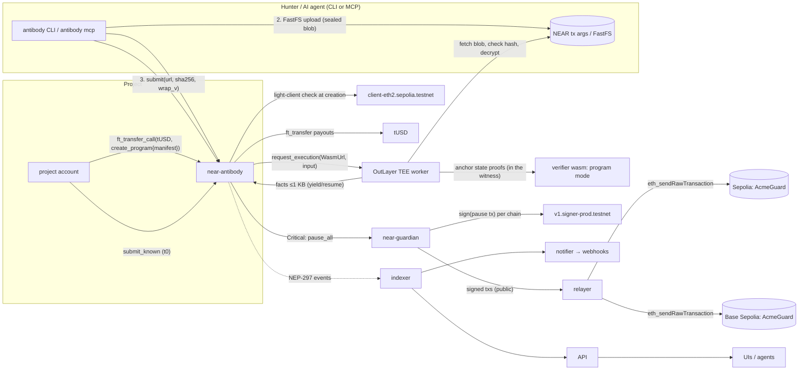

# Architecture

## Components

| Path | Role |
|---|---|
| `crates/verifier` | Deterministic verifier (native and `wasm32-wasip2`): program mode, receipts, facts, TEE request handling, sealed-submission crypto |
| `crates/witness` | Builds proven witnesses: traces the PoC through the verifier's own program path, fetches proofs at the anchor, then runs a strict fixpoint |
| `crates/runner` | wasmtime host with OutLayer's engine config (fuel, epochs, wasi:http) for local wasm runs |
| `crates/cli` | `antibody` CLI and MCP server; NEAR client with in-process signing |
| `crates/services` | Indexer, API, relayer, notifier, sandbox mocks, offline demo |
| `contracts/near-antibody` | Settlement contract, the tUSD token, and the sandbox-only MOCK OutLayer and MOCK MPC |
| `contracts/near-guardian` | Chain Signatures pause signer for every registered chain |
| `contracts/evm` | The Acme Lend fixture (deliberately vulnerable), its invariants, PoCs and deploy script |

## One submission, end to end

1. **Commit.** The hunter builds a witness locally (state proofs at the anchor), seals it to the program's verifier key, and commits `SHA-256("antibody/commit/v1|program|hunter|sha256(blob)")`. The bond is locked from the hunter's internal balance.
2. **Upload.** The sealed blob goes into a FastFS transaction. Its location is the FastFS gateway URL or `near-tx:<hash>:<signer>`.
3. **Reveal.** `submit(commit, {url, sha256, wrap_v})` checks the commitment and calls OutLayer's `request_execution` with a small JSON input that names the pinned verifier wasm.
4. **Verify (TEE).** The verifier:
   1. fetches the blob, checks its hash and unwraps the content key with the key derived from its protected seed;
   2. checks that the payload is bound to this program and hunter, and that the manifest hash matches;
   3. verifies every proof and runs the PoC;
   4. evaluates the invariants at every protocol-entry call and attributes each break to its last flip;
   5. prints the facts: verdict, mask, HMAC fp_tags, impact, project wrap, receipt hash.
5. **Callback.** near-antibody validates the facts against the request and applies the rules:
   - keys and priority;
   - the bond: refunded on Violation, forfeited otherwise;
   - a Critical triggers the guardian.
6. **Finalize.** Once the reveal windows of all earlier commits have closed, the commit is paid, marked Duplicate (with proof) or marked Known. Payouts above the instant cap wait the T0 challenge delay.
7. **Disclosure.** After `deadline + disclosure_after`, one TEE run publishes every content key and `k_program`. `antibody verify` then recomputes every receipt and tag.

## Determinism

The verifier has no clock, network or randomness inside a verification. Two things make it deterministic:

- **The witness fixes everything:** state, code and headers.
- **The manifest fixes the rules:** invariants code, capabilities, prices and the EVM spec.

Native and wasm runs produce byte-identical receipts; CI enforces this on the recorded fixtures.
