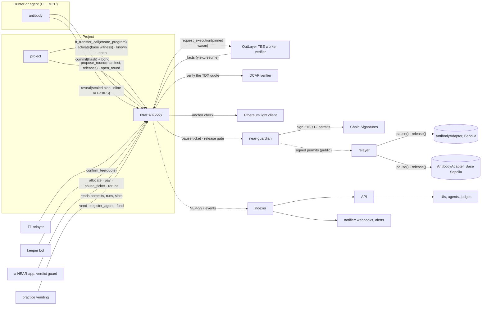

# Architecture

## Components

| Path | Role |
|---|---|
| `crates/verifier` | The deterministic verifier (native and `wasm32-wasip2`): program mode, rounds, fork mode, receipts and facts, TEE request handling, sealed-submission crypto |
| `crates/witness` | Witnesses: base witnesses traced through the activation checks, PoC witnesses through the verifier's own path, and submissions sealed against the pinned base alone |
| `crates/rules` | The settlement rule core near-antibody runs (Kani proofs, replayed against the Quint model) |
| `crates/runner` | A wasmtime host with OutLayer's engine configuration, for local wasm runs |
| `crates/cli` | `antibody`: the CLI and MCP server, the practice try-it, the judge view, rule strength, Foundry compatibility, the drafter, T1 tools |
| `crates/services` | Indexer, API, keeper bot, relayers (permits, T1), notifier and monitoring, sandbox mocks, the demo |
| `contracts/near-antibody` | Settlement contract and the sandbox-only mocks (OutLayer, DCAP, MPC, light client, tUSD) |
| `contracts/near-guardian` | Pause and release permits signed with Chain Signatures under each program's own path |
| `contracts/practice-vending` | Practice accounts with scoped keys and bond credit |
| `contracts/practice-account` | A practice account's own contract: passes its key's calls on to near-antibody, and closes the account when its try is done |
| `contracts/verdict-guard` | A NEAR app consuming verdicts: a treasury that freezes on a verified Critical |
| `contracts/evm` | `AntibodyAdapter`, Acme Lend (deliberately vulnerable) with its rules, proofs and fixes, the practice vaults |
| `formal/` | The Quint model of the settlement rules |

## One proof, end to end

1. **Commit.** The hunter builds the witness (from the pinned base witness when the proof reads only
   base state, else from an RPC at the anchor), seals it to the program's key, and commits its hash with
   the bond. Priority is the commit's order.
2. **Reveal.** `reveal` checks the blob against the commitment and asks OutLayer to run the pinned
   verifier on it, paid from the requester's NEAR credit.
3. **Verify (TEE).** The verifier opens the sealed blob, merges it with the pinned base, checks every
   proof against the anchor's state root, applies a fork-mode deployment and the round's code, runs the
   proof from fresh senders, evaluates the rules at the end of every protocol-entry call, attributes each
   break to its entry point, and returns the facts.
4. **Callback.** near-antibody checks the facts against its own request and applies the rules: a
   holder, a duplicate, a known issue, a gap-lane claim, or a forfeited bond.
5. **T1.** The relayer brings the run's TDX quote; near-antibody verifies it on chain. Instant payouts
   need it.
6. **Settle.** The keeper allocates final verdicts in commit order and pays funded claims: in seconds
   under the instant cap; above it, after an agreeing second run and the challenge window. A Critical in
   the pause policy gets the round's pause ticket, and near-guardian signs a pause permit for every chain.
   Once a finding is paid, the project asks for its release wrap and reads the proof
   (`antibody program read`); nothing else is ever wrapped to the project.
7. **Rounds.** The project proposes a fix as code at the same anchor; the TEE checks it; every paid proof
   is re-run against it; the round opens, releasing the keys that no longer break; if the release gate
   holds, near-guardian signs release permits for exactly the code the re-runs ran (docs/rounds.md).
8. **Disclosure.** Once its condition holds, one TEE run publishes every content key, so anyone can
   recompute every verdict.

## Determinism

The verifier has no clock, network or randomness inside a verification. The witness fixes the state, the
code and the headers; the manifest fixes the rules, the capabilities, the prices and the EVM rules.
Native and wasm runs produce byte-identical receipts, and CI checks it on every recorded fixture.
